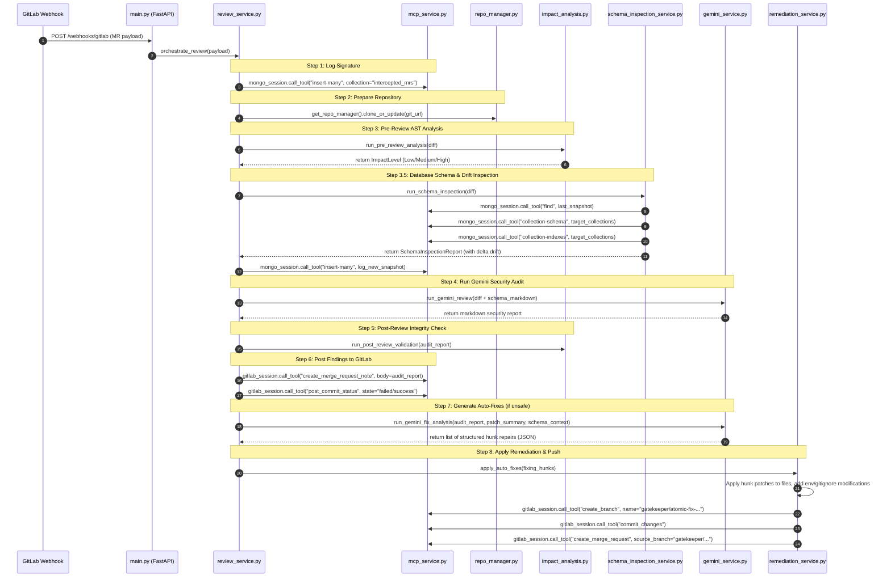

# Gatekeeper System Context & Execution Flow

This document outlines the system architecture, file structure, and step-by-step execution flow of **The Gatekeeper** code audit and auto-remediation service. It is designed to serve as system context for another Large Language Model (LLM).

---

## 1. High-Level Architecture & Stack
* **Framework**: FastAPI (Python 3.x)
* **Databases**: MongoDB (logs webhooks via stdio MCP bridge)
* **Integrations**: GitLab (reads diffs, posts review comments, manages PR branches), GitNexus (performs pre-review static analysis)
* **AI Engine**: Gemini Pro API (analyzes security vulnerabilities, generates structured hunk-level auto-fixes)
* **Interprocess Communication**: Model Context Protocol (MCP) stdio servers running locally:
  * MongoDB MCP Server: `mongodb-mcp-server/dist/esm/index.js`
  * GitLab MCP Server: `@zereight/mcp-gitlab/build/index.js`
  * GitNexus MCP Server: `gitnexus` CLI

---

## 2. Directory Layout & Module Responsibilities

```
gatekeeper/
├── main.py                     # FastAPI entry point, defines startup hooks and API endpoints.
├── requirements.txt            # Python dependencies (fastapi, uvicorn, pymongo, google-genai, python-dotenv).
├── package.json                # Local Node dependencies (MongoDB/GitLab MCP clients, GitNexus CLI).
├── setup_repos.py              # CLI tool to register, list, and index GitLab repositories.
├── setup_impact_analysis.py    # Helper script to test and verify local GitNexus installation.
├── repo_manager.py             # Handles local workspace directory setups and git clones.
├── impact_analysis.py          # Performs AST / static analysis of diffs to determine change severity.
├── atomic_patches.py           # Parser to read unified diff format and extract code hunks.
├── services/
│   ├── __init__.py             # Module initializer.
│   ├── mcp_service.py          # Initializes and holds stdio pipes/sessions for MongoDB, GitLab, and GitNexus.
│   ├── gemini_service.py       # Handles communication with Gemini API (loads prompts, requests reviews & fixes).
│   ├── remediation_service.py  # Applies hunk-level diff patches, creates fix branches, commits, and opens MRs.
│   └── review_service.py       # Pipeline orchestrator coordinating the entire analysis flow.
└── test_project/               # Nested repository containing intentionally vulnerable mock endpoints for testing.
```

---

## 3. End-to-End Execution Flow (MR Webhook Event)

When a developer opens or updates a Merge Request in GitLab, the following sequential pipeline executes:



---

## 4. Specific Webhook Pipeline Logic Details

### Webhook Event Filters
* The orchestrator filters out any MR events that are not in the `"opened"` state.
* The orchestrator ignores incoming webhook requests originating from source branches prefixed with `"gatekeeper/"` to prevent recursive, infinite loop reviews.

### Database Schema Drift & Inspection Engine (Step 3.5)
* **Backend Change Detection**: Scans unified diff headers for models/migrations folders and matches added lines (`+` statements) in diff bodies for MongoDB operations (e.g., `.insert_one(`, `.find(`, `db[`).
* **Confidence Gating**:
  * `HIGH` (Models/Migrations path match) -> full MCP inspection (falls back to all collections if scoping yields nothing).
  * `MEDIUM` (Soft path match or keyword content match) -> scoped MCP inspection only (no fallback).
  * `LOW` (Config file single-occurrence keyword match) -> skips MCP queries entirely.
* **Decoupled Collection Discovery**: Parses target collections directly from the code diff stream using regular expressions, eliminating the need to execute the broad `list-collections` MCP tool call.
* **Drift Comparison**: Queries `schema_snapshots` collection for the latest logged baseline for the current project, computes differences (added/removed collections, added/removed fields, field type transformations), and injects the delta warnings directly into the Gemini prompt (both for review and auto-fix patch generation phases).

### Hunk-Level Remediation Structure
Gemini is prompted to return suggested auto-fixes formatted in a strict JSON schema conforming to the following structure:
```json
{
  "explanation": "Why this fix is being applied",
  "modifications": [
    {
      "filePath": "path/to/file.py",
      "startLine": 12,
      "endLine": 15,
      "originalCode": "...",
      "newCode": "..."
    }
  ]
}
```
`remediation_service.py` iterates over these modifications, verifies that the `originalCode` block matches the file content, performs safe in-place replacement, writes secrets to `.env`, and updates `.gitignore`.

---

## 5. Development & Execution Commands

### Run FastAPI Audit Server
Starts the orchestrator server locally on port 8000:
```bash
venv/bin/python -m uvicorn main:app --host 0.0.0.0 --port 8000
```

### Register/Manage GitLab Repositories
Add a GitLab repository configuration to monitor:
```bash
venv/bin/python setup_repos.py add <project_id> <gitlab_repository_url>
```
Force pre-indexing and analyze codebase structures using GitNexus:
```bash
venv/bin/python setup_repos.py index
```
